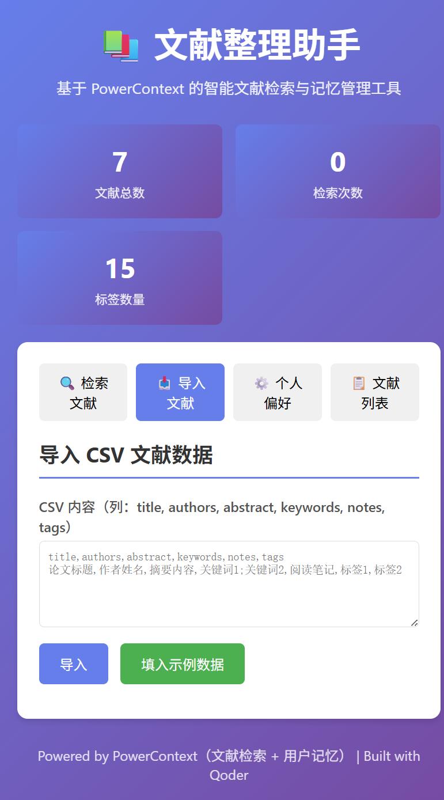
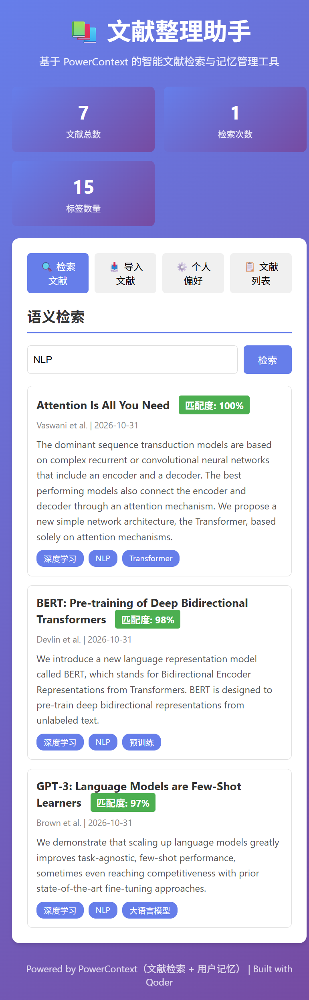
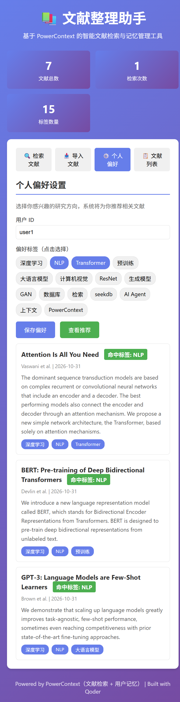

# 文献整理助手 - Research Assistant

基于 **PowerContext** 的文献管理与检索助手：把论文导入成可检索的知识库，并让 PowerContext 记住你的研究方向，
下次打开时自动召回偏好、生成个性化推荐。

> 本项目为 OceanBase 2026 训练营「Qoder 综合赛道」作品，位于 `powercontext` 仓库 `qoder-competition` 分支的
> `qoder/research-assistant` 目录（该分支基于 `2026-competition-ecosystem`）。

## 项目简介

整理文献要翻几十篇论文，复习时找不到上学期的笔记，每次打开工具都要重新选择研究方向。
**文献整理助手**把“文献入库、检索、偏好记忆、推荐”收敛到一条由 PowerContext 驱动的链路中：

- 文献以 Memory 的形式写入共享“文献库” Scope；
- 检索直接调用 PowerContext 的全文检索（FTS）；
- 用户偏好写入每个用户独立的 Scope，可跨会话召回；
- 推荐先召回偏好，再按标签检索文献库，推荐理由可解释。

它不是一个静态演示页：后端真实启动进程内 PowerContext（ASGI + SQLite），所有功能都走实际接口。

## 解决的问题

| 痛点 | 本项目做法 |
|------|-----------|
| 文献分散在表格/笔记里，检索靠人工翻找 | 每篇文献写入 PowerContext Memory，统一全文检索 |
| 兴趣偏好无法跨会话保留 | 偏好写入用户独立 Scope，随时召回 |
| 推荐是写死规则，缺乏记忆依据 | 偏好 Memory → 标签 → 文献检索，形成可解释推荐链 |

## 核心功能

1. **CSV 批量导入**：`remember_memory(kind="paper")` 逐篇写入文献库 Scope。
2. **全文检索**：`search_memory(mode="fts")` 返回命中文献，并按组内最高分展示相对匹配度。
3. **偏好记忆**：`remember_memory(kind="preference")` 保存到 `user:{id}` Scope。
4. **个性化推荐**：`search_memory` 召回偏好 → 解析标签 → 逐标签检索文献库。

## 技术栈

| 组件 | 技术 | 作用 |
|------|------|------|
| 记忆与检索 | **PowerContext 1.2.0** | Scope / Memory 存储、FTS 检索、偏好召回（核心） |
| 后端 | FastAPI + uvicorn | REST API，托管前端页面 |
| 前端 | 原生 HTML / CSS / JavaScript | 导入、检索、偏好、推荐界面 |
| 存储 | SQLite（PowerContext 内置） | 本地持久化，无需外部数据库 |
| 开发 / 发布 | Qoder、Qoder Sites | 开发辅助与网站发布 |

> seekdb 未参与功能流程（`pylibseekdb` 仅支持 Linux/macOS）。赛题要求 seekdb 与 PowerContext 至少选择一种，
> 本项目选择 PowerContext，并在核心链路中实际使用。

## 快速开始

```bash
git clone -b qoder-competition https://github.com/orange179/powercontext.git
cd powercontext/qoder/research-assistant
python -m venv .venv
.venv\Scripts\activate        # Windows；macOS/Linux 用 source .venv/bin/activate
pip install -r requirements.txt
python backend/main.py
# 打开 http://127.0.0.1:8000
```

完整环境、演示步骤、API 与故障排查见 [docs/RUNNING.md](docs/RUNNING.md)。

## 验证样例

```bash
python scripts/test_backend.py
```

真实输出（PowerContext 1.2.0）：

```text
[startup] PowerContext ready, search_modes=[auto, fts]
[import] 200 imported= 7
[search] 200 hits= 3
[save prefs] 200 {'status': 'ok', 'preferred_tags': ['NLP', 'Transformer']}
[recall prefs] 200 {'preferred_tags': ['NLP', 'Transformer']}
[recommendations] 200 ['Attention Is All You Need', 'BERT: ...', 'GPT-3: ...']
[health] 200 {'tech': 'PowerContext', ...}
[DONE] backend + PowerContext end-to-end OK
```

| 步骤 | 输入 | 预期结果 | 实测 |
|------|------|----------|------|
| 导入 | `data/sample_papers.csv` | 7 篇文献写入 PowerContext | 7 篇 ✓ |
| 检索 | `NLP` | 返回相关文献与匹配度 | 3 条 ✓ |
| 保存偏好 | `[NLP, Transformer]` | 写入 user1 Scope | revision=1 ✓ |
| 召回偏好 | — | 从 PowerContext 读回 | NLP, Transformer ✓ |
| 推荐 | — | 偏好驱动文献检索 | 3 条 ✓ |

## 演示截图

| 导入 7 篇文献 | 检索 NLP | 偏好记忆驱动的推荐 |
|---|---|---|
|  |  |  |

截图来自本地真实运行的应用。

## 项目结构

```text
research-assistant/
├── backend/
│   ├── main.py              # FastAPI 应用与 PowerContext 记忆/检索流程
│   └── pc_runtime.py        # 进程内启动 PowerContext Server 并返回客户端
├── frontend/index.html      # 应用界面
├── data/sample_papers.csv   # 示例文献
├── scripts/
│   ├── test_backend.py      # 端到端验证（导入→检索→偏好→推荐）
│   └── verify_powercontext.py  # 最小记忆写入/召回验证
├── docs/
│   ├── RUNNING.md           # 运行说明
│   └── demo-*.png           # 演示截图
├── dist/index.html          # Qoder Sites 项目展示页
├── requirements.txt         # powercontext[server]==1.2.0
└── README.md
```

## 在线体验

- 项目网站（Qoder Sites）：<https://research-assistant-vxnv854uztp.qoder.zone>
- 网站为静态展示与使用说明；完整交互请按上面“快速开始”在本地运行。

## 开发记录

- Qoder UID：`nick4039665807`
- 开发过程：Qoder 协助完成需求梳理、PowerContext 进程内集成、后端 API、前端界面、截图与发布验证。
- 详细记录见 [docs/QODER_LOG.md](docs/QODER_LOG.md)（可另附 Qoder 对话截图/录屏）。

## 许可证

MIT License
