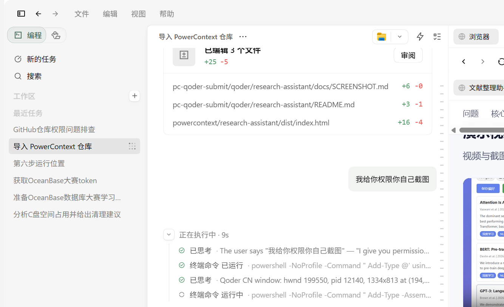
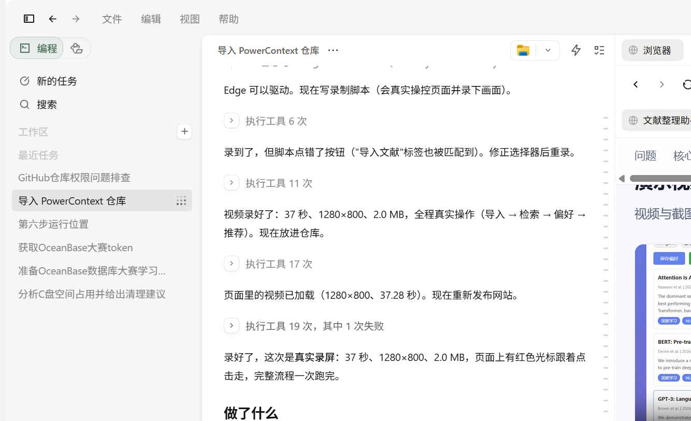

# Qoder 开发记录

- **Qoder UID**：`nick4039665807`
- **项目**：文献整理助手（Research Assistant）
- **提交目录**：`qoder/research-assistant`（分支 `qoder-competition`，基于 `2026-competition-ecosystem`）

## 开发过程

| 阶段 | 内容 | Qoder 的作用 |
|------|------|--------------|
| 1. 需求梳理 | 确定“文献导入 + 全文检索 + 偏好记忆 + 推荐”四个能力 | 梳理赛题要求，确定以 PowerContext 作为核心记忆组件 |
| 2. 技术验证 | 验证 PowerContext 可在 Windows 上以进程内 ASGI + SQLite 运行 | 定位 `ASGITransport` 不自动运行 lifespan 的问题，改为显式 `lifespan_context` |
| 3. 后端实现 | `pc_runtime.py` + `main.py` | 完成 Scope 创建、`remember_memory`、`search_memory`、偏好召回与推荐链路 |
| 4. 前端实现 | `frontend/index.html` | 完成导入、检索、偏好、推荐的交互与错误提示 |
| 5. 依赖修复 | 移除 `pylibseekdb`，改为 `powercontext[server]==1.2.0` | 解决“依赖不存在/冲突”与跨平台无法运行的问题 |
| 6. 验证 | `scripts/test_backend.py`、`verify_powercontext.py` | 端到端跑通并保留输出证据 |
| 7. 数据持久化修复 | `_load_library` 启动时从 PowerContext 读回文献；偏好改为直接 `list_memory_entries` 召回；新增 `scripts/test_persistence.py` | 修复“重启后文献列表为空、记忆无法复用”，并用两次启动的脚本验证 |
| 8. 发布 | `dist/index.html` + Qoder Sites | 发布项目展示页，公开访问 |

## 验证结论

- PowerContext 能力：`search_modes=[auto, fts]`
- 导入 7 篇文献 → 检索 `NLP` 命中 3 篇（100% / 98% / 97%）→ 保存偏好 → 召回偏好 → 推荐 3 条
- 重启验证：关闭应用后重新启动，`[startup] restored 7 papers from PowerContext`，文献列表、检索、偏好、推荐全部可用（`scripts/test_persistence.py`）
- 全部接口均为真实调用，非模拟数据

## Qoder 对话截图 / 录屏

以下截图直接抓取自 Qoder CN 客户端窗口（账号 UID `nick4039665807`），记录本项目在 Qoder 中完成需求澄清、代码修改、截图与录屏、提交验证的过程。

### 1. 对话与文件改动

### 2. 截图 / 录屏与发布过程

### 配套材料

- 演示视频：`docs/demo-walkthrough.mp4`（37 秒真实录屏）
- 运行截图：`docs/demo-01-home.png` … `docs/demo-05-site.png`
- 站点：<https://research-assistant-vxnv854uztp.qoder.zone>
