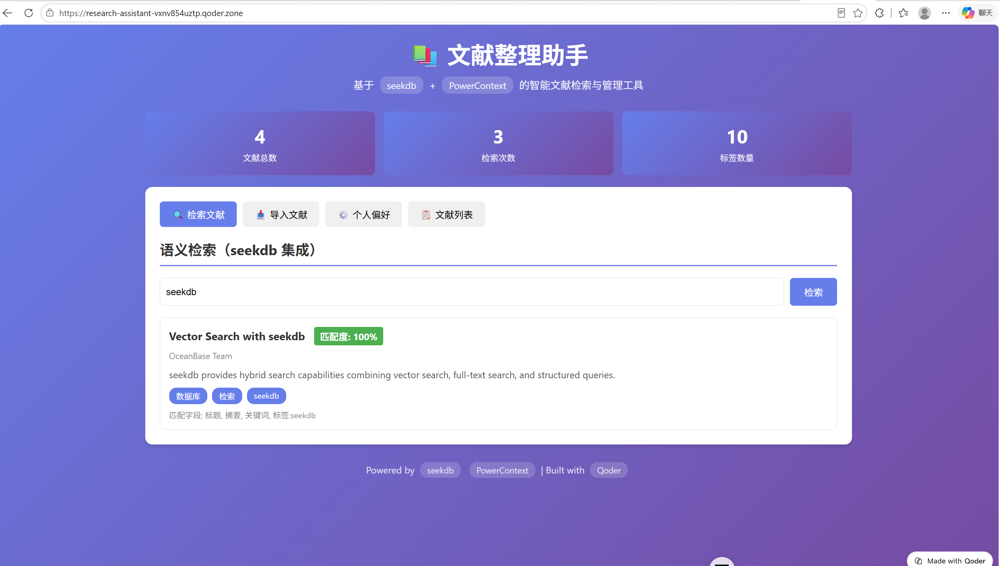

# 项目网站截图

## Qoder Sites 发布版本

**Qoder Sites 访问地址：** <https://research-assistant-vxnv854uztp.qoder.zone>（公开访问）

> 注：`screenshot-qoder-sites.png` 为早期版本界面截图；当前网站与截图见下方。

## 演示视频

`demo-walkthrough.mp4`（37 秒，1280×800，真实操作录屏）

完整流程：导入示例数据（7 篇 / 15 标签）→ 文献列表 → 检索 `NLP`（3 条命中）→ 选择偏好 `NLP` 并保存 → 召回记忆生成 3 条推荐。

## 真实运行截图（2026-10-31 录制，按使用顺序）

| 截图 | 内容 |
|------|------|
| `demo-01-home.png` | 启动后首页，统计为 0 篇文献 |
| `demo-02-import-filled.png` | 点击“填入示例数据”，CSV 内容载入输入框 |
| `demo-02-import.png` | 导入完成，7 篇文献 / 15 个标签，列表可见 |
| `demo-03-search.png` | 检索 `NLP`，PowerContext FTS 返回 3 篇，匹配度 100% / 98% / 97% |
| `demo-03b-preferences.png` | 选择偏好标签 `NLP` 并保存到 PowerContext 记忆 |
| `demo-04-recommendations.png` | 召回偏好记忆，生成 3 条带“命中标签”的推荐 |
| `demo-05-site.png` | 发布的网站首页（作品介绍页） |

## 技术集成

- **PowerContext 1.2.0**：文献存储、全文检索、用户偏好记忆（真实调用）
- **Qoder**：开发辅助 + Qoder Sites 发布

截图时间：2026-10-31
发布平台：Qoder Sites
